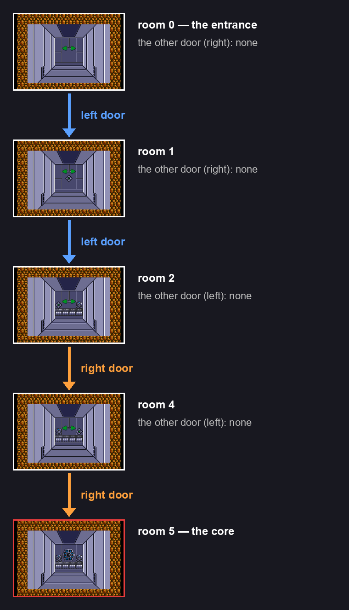
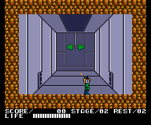
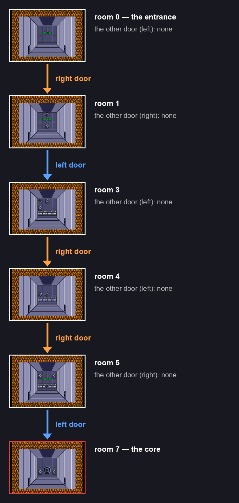
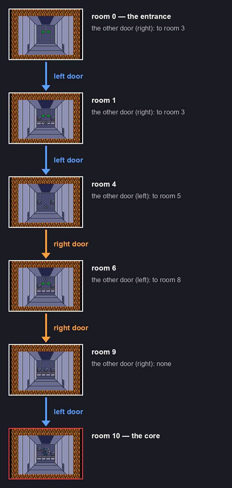
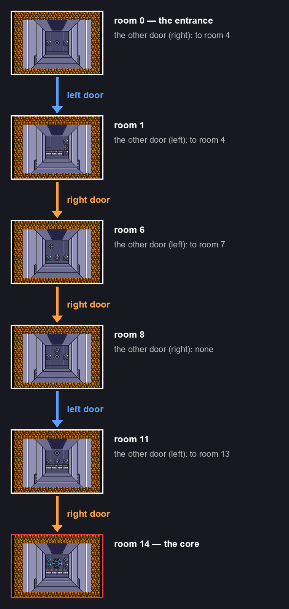
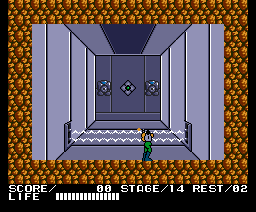

# The bases

Four stages are **3D bases**, seen from behind the player: 1ST UNDERPASS (stage 2), 2ND UNDERPASS (5), 1ST UNDER MAZE (11) and 2ND UNDER MAZE (14) (the list at `p00:532C`). Each is a maze of rooms; the last one is the core's.

## How you get around

- On the back wall of each room there are targets. With all of them destroyed (`0xE18B` = 0xFF), pushing up takes the player into the corridor (`p03:AFC1`): he walks 0x2F frames towards the back (`p03:B1AE`).
- In the corridor, leaving on the left (x < 0x60, `p03:B14A`) or on the right (x ≥ 0x90, `p03:B191`) leads to the room given by the base's table. If the table says 0xFF, there is no door on that side.
- In the first room of the first three bases you can enter the corridor without destroying anything; in the 14th's, you cannot (`p03:AFC7-AFD8`).

Rooms other than the first only bring their back wall: when the room changes (`p03:B16F-B180`) it is drawn over the frame the first one left. That is why every room in the route is drawn over the first.

## The route

For each base, the shortest way from the entrance to the core, top to bottom: every room with its screen, drawn by the cartridge; between one room and the next, the door to take (blue the left, orange the right); and next to each room, where its other door leads.

The doors do not make a map with a shape: for each room, the cartridge only keeps in a table the room each door leads to. A room can be reached from two (room 4 of stage 11, through the left door of 1 and the right door of 5), and there are corridors there and back (from 4 through the left you reach 5, and from 5 through the right, 4).

There are rooms **no door leads to**: they are in the ROM, with their screen and their objects, but the game never goes in. The room is only changed by a door, by the section a stage starts with (0 in the bases), by the one of a loaded game (not used in the bases, `p00:44B9`) and by the screen change of the stages that are not bases.

## Stage 2: 1ST UNDERPASS

Five rooms and the core (room 5). Room 3 has no way in.

## Stage 5: 2ND UNDERPASS

Seven rooms and the core (room 7). Rooms 2 and 6 have no way in.

## Stage 11: 1ST UNDER MAZE

Ten rooms and the core (room 10). Rooms 2 and 7 have no way in.

## Stage 14: 2ND UNDER MAZE

Fourteen rooms and the core (room 14). Six have no way in: 2, 3, 5, 9, 10 and 12.

