# The bosses

Every stage ends in its boss, on the last screen in the direction the stage goes. The cartridge gives them no names. When it is destroyed, the stage is cleared (`0xE184` = 1, as in `p02:8915`) and the boss-destroyed tune plays, 0x0E, or 0x0F in stage 19 ([The music](THE-MUSIC.html)).

The clips are the game run from the boss's screen, with the player firing. In the bases, the game starts in the first room and the first door crossed leads to the core's, because a room other than the first does not bring its frame ([The bases](THE-BASES.html)).

## Stage 1: the wall

The base's wall at the end of the jungle, with its cannons.

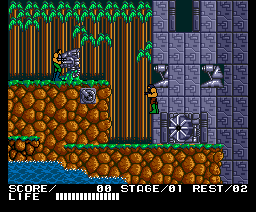

## Stages 2, 5, 11 and 14: the base's core

The last room of each base: the core on the back wall, with an electric barrier in front.

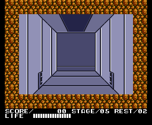

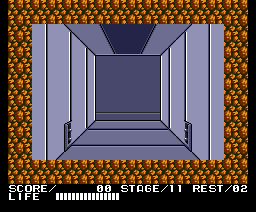

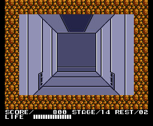

## Stages 3, 6, 12 and 15: HOMICIDE CENSOR

The wall of each base's boss, with its targets.

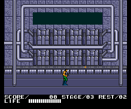

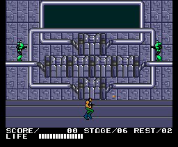

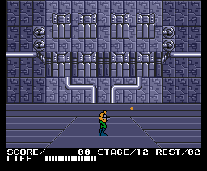

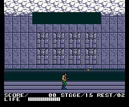

## Stage 4: the waterfall tower

At the top of HELL FALL, a tower with an alien head on top.

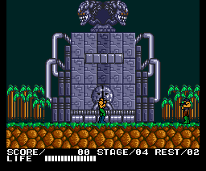

## Stages 7 and 8: the giant soldier

The same soldier at the end of TUNDRA AREA and of ENERGY ZONE.

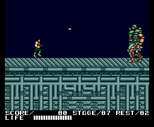

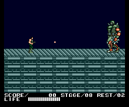

## Stage 9: the heart

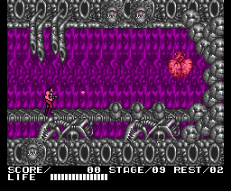

## Stages 10, 13, 16, 17 and 18: the cores

A hexagonal core with turrets, at the far end of the caves, the lava and the fortress.

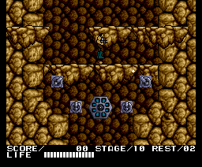

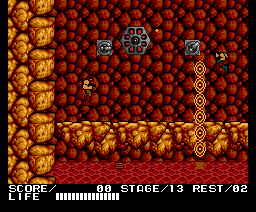

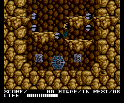

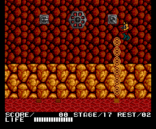

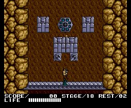

## Stage 19: the last boss

An eye between jaws, on the lair's wall. Destroying it brings the ending ([The sequences](THE-SEQUENCES.html)).

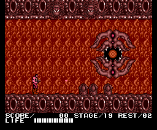
