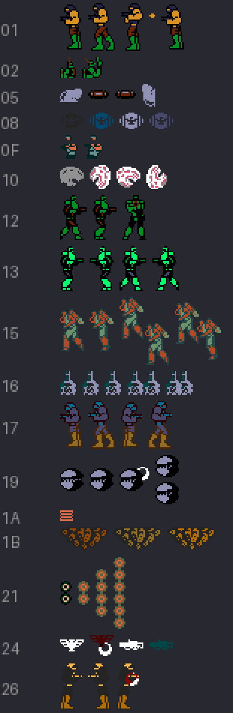

# The enemies

Every object in the game is a 16-byte slot at `0xE300` (the player is the first four) with a **type** (`IY+4`): the number of the routine that moves it, from the table at `p02:8000`. The sheet gathers what has been seen of each type playing **every stage and every section** (`tools/sprites.py`), with the sprites as the V9938 draws them: each one 16 x 16 and, when two in a row have the CC bit, their colours added together. One row per type; the same type can wear different drawings in each stage.

Many enemies are not sprites: the turrets, the cannons and the cores are drawn into the background (`p02:8400`), and you can see them in [The stages](THE-STAGES.html) and in [The bosses](THE-BOSSES.html).

The player's bullets and the other types that are not enemies (the `NO_ENEMIGOS` list in `tools/sprites.py`) are left out of the sheet.
