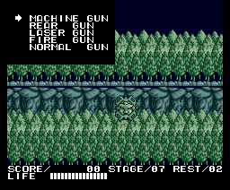
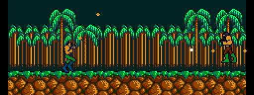
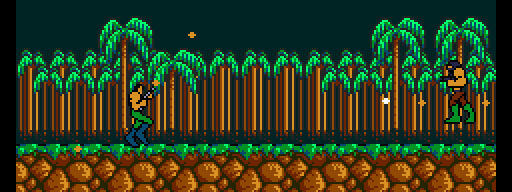
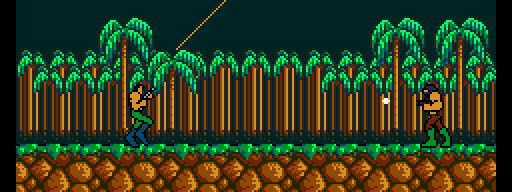
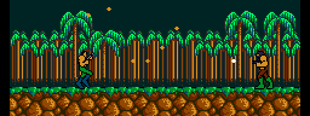

# The player and the weapons

## The controls

- Walk and aim: the cursor keys or the joystick (GTSTCK 0 and 1, `p00:4F5F-4F6F`).
- Fire: space or joystick button 1 (`p00:4F02-4F0D`).
- Jump: M, N or button 2 (`p00:4F38-4F44`). Letting go of the button early makes the jump shorter (`p03:B65D`).
- F1: pause. While paused, S saves the game and L loads it, with the *Game Master 2* ([Curiosities](CURIOSITIES.html)).

## Lives and energy

You start with **three lives** (`p00:4261`) and the LIFE bar full: **16** of energy (`0xE2C9`, `p00:4266`). Each hit pushes the player back and, when the push ends, takes away the energy given by whatever hit him (`p03:AF01`). With no energy left you lose a life, and with it the weapons and the capsules (`p03:AF44`).

## The capsules

The first four capsules picked up in a game (`0xE030`, `p00:4C77`) improve the player:

- the 1st and 2nd, **faster** (`0xE033`): with one he moves every frame, instead of one in two (`p03:AE75`); with two, a little faster still (`p03:B1F2`);
- the 3rd and 4th, **higher jumps** (`0xE031`, the tables `p03:B777` and `p03:B797`);
- with any of them, every hit takes **two less** (`p03:AF05`).

## The weapon menu

Another capsule, the one with drawing 0x2C, **opens the weapon menu** (`p02:958D`, `p03:BEAC`): up and down move the arrow and the jump button chooses.

What the menu offers depends on the stage (`p00:513A-5160`, `p03:BEE3`):

| Weapon | From stage |
|---|---|
| MACHINE GUN | 1 |
| REAR GUN | 4 (HELL FALL) |
| LASER GUN | 7 (TUNDRA AREA) |
| FIRE GUN | 7 |
| NORMAL GUN | 1 |

The clips: stage 1 with each weapon, firing forward and diagonally.

### NORMAL GUN

### MACHINE GUN

### REAR GUN

### LASER GUN

### FIRE GUN

The LASER GUN only has two shots at a time (`p03:B990`). In the bases, every weapon but the NORMAL GUN fires the MACHINE GUN's bullet (`p03:B9C3`).
