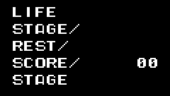
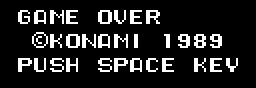
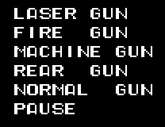
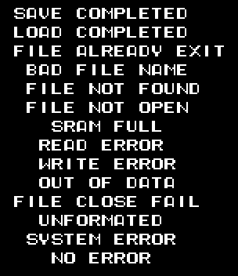
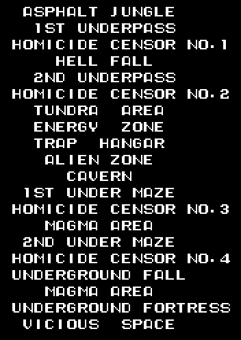
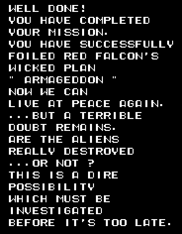

# The texts

All the texts are in English, in the cartridge's own 8 x 8 lettering, which sits in page 0 of the VRAM from line 0xD8 on: 0x00-0x09 the digits, 0x10 the space, 0x11-0x2A A-Z, 0x0A ©, 0x0B an arrow and 0x2B-0x31 `/ . - " ! ? '`. Each byte of a string is the number of its drawing, and the string ends in 0xFF (`p00:48D3`). The images are **drawn from the bytes of the ROM** with that lettering (`tools/textos.py`).

## The status bar

`p00:4632-4651` and `p00:4508`.

## The title and game over

`p00:502B-5050`.

## The weapons and the pause

`p00:53AF-53EA`.

## Saving and loading

The messages for saving and loading the game on the *Game Master 2* (`p00:53EB-54C9`), with two typos from the cartridge: FILE ALREADY EXIT and UNFORMATED.

## The stage names

The table at `p12:974C`: twenty pointers, one per stage, including the one the game skips (TRAP HANGAR). MAGMA AREA appears twice.

## The ending

`p12:9622-974B`.

    WELL DONE!
    YOU HAVE COMPLETED YOUR MISSION.
    YOU HAVE SUCCESSFULLY FOILED RED FALCON'S WICKED PLAN " ARMAGEDDON "
    NOW WE CAN LIVE AT PEACE AGAIN.
    ...BUT A TERRIBLE DOUBT REMAINS. ARE THE ALIENS REALLY DESTROYED ...OR NOT ?
    THIS IS A DIRE POSSIBILITY WHICH MUST BE INVESTIGATED BEFORE IT'S TOO LATE.
