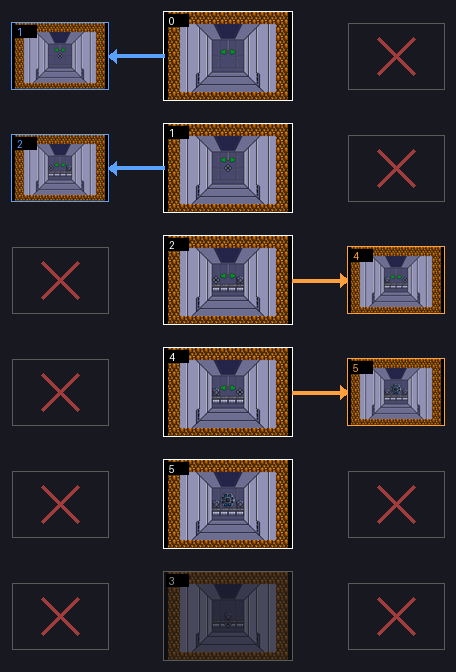
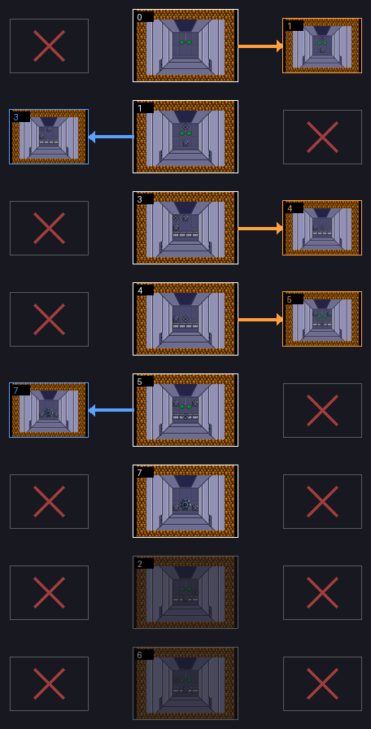
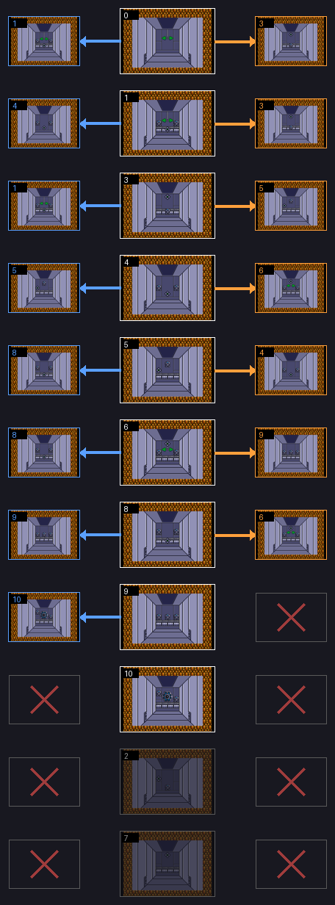
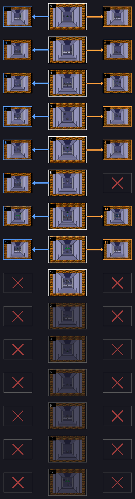

# Las bases

Cuatro fases son **bases en 3D**, vistas desde detrás del jugador: 1ST UNDERPASS (fase 2), 2ND UNDERPASS (5), 1ST UNDER MAZE (11) y 2ND UNDER MAZE (14) (la lista `p00:532C`). Cada una es un laberinto de salas; la última es la del núcleo.

## Cómo se anda

- En la pared del fondo de cada sala hay blancos. Con todos rotos (`0xE18B` = 0xFF), la palanca hacia arriba mete al jugador en el pasillo (`p03:AFC1`): anda 0x2F cuadros hacia el fondo (`p03:B1AE`).
- En el pasillo, saliendo por la izquierda (x < 0x60, `p03:B14A`) o por la derecha (x ≥ 0x90, `p03:B191`) llega a la sala que dice la tabla de su base. Si la tabla dice 0xFF, por ese lado no hay puerta.
- En la primera sala de las tres primeras bases se entra en el pasillo sin romper nada; en la de la 14, no (`p03:AFC7-AFD8`).

Las salas que no son la primera solo traen la pared del fondo: al cambiar de sala (`p03:B16F-B180`) se pinta encima del marco que dejó la primera. Por eso cada sala del mapa está montada sobre la primera.

## Los mapas

Cada mapa es la tabla de puertas de su base: una fila por sala; a la izquierda, la sala a la que lleva la puerta izquierda, y a la derecha, la de la derecha. Una X donde no hay puerta. Cada sala está pintada por el cartucho, como las pantallas de [Las fases](LAS-FASES.html).

Las salas apagadas son las que **ninguna puerta lleva**: están en la ROM, con su pantalla y sus objetos, pero el juego no entra nunca. La sala solo la cambian la puerta, el tramo con que empieza la fase (el 0 en las bases), el de una partida cargada (que en las bases no se usa, `p00:44B9`) y el paso de pantalla de las fases que no son bases.

## Fase 2: 1ST UNDERPASS

Cinco salas y el núcleo (la 5). La 3 no tiene entrada. El camino: 0, izquierda a la 1, izquierda a la 2, derecha a la 4, derecha al núcleo.

## Fase 5: 2ND UNDERPASS

Siete salas y el núcleo (la 7). La 2 y la 6 no tienen entrada. El camino: 0, derecha a la 1, izquierda a la 3, derecha a la 4, derecha a la 5, izquierda al núcleo.

## Fase 11: 1ST UNDER MAZE

Diez salas y el núcleo (la 10). La 2 y la 7 no tienen entrada. El camino más corto: 0, izquierda a la 1, izquierda a la 4, derecha a la 6, derecha a la 9, izquierda al núcleo.

## Fase 14: 2ND UNDER MAZE

Catorce salas y el núcleo (la 14). Seis no tienen entrada: la 2, 3, 5, 9, 10 y 12. El camino más corto: 0, izquierda a la 1, derecha a la 6, derecha a la 8, izquierda a la 11, derecha al núcleo.

