# Las fases

**Diecinueve fases** seguidas: ocho que se recorren de lado, cuatro de subir o bajar, cuatro bases en 3D ([Las bases](LAS-BASES.html)) y, después de cada base, la pared de su jefe. Al acabar la 19 sale el final y el juego vuelve al título. En la ROM hay una vigésima, TRAP HANGAR, con nombre, pantallas y música, que el juego se salta siempre ([Curiosidades](CURIOSIDADES.html)).

Contra no tiene scroll: va **por pantallas**. Al salir por un borde se pinta la siguiente de la lista de la fase (`p03:B58B`). Los mapas están **pintados por el propio cartucho**: cada pantalla la construye su rutina (`p03:BB3C`), ejecutada fuera del emulador, y se ponen en el orden en que el juego pasa de una a otra. La primera pantalla de cada fase se ha cotejado con la VRAM de openMSX: en ocho (la 1, 2, 4, 5, 6, 8, 9 y 11), las 176 líneas iguales byte a byte; en las demás cambian las torretas y otras piezas que la rutina de cada objeto pinta encima del fondo (`p02:8400`), que el mapa no lleva.

Los clips son la partida ejecutada cuadro a cuadro, con el jugador yendo hacia donde va la fase y disparando.

## Fase 1: ASPHALT JUNGLE

La jungla, con el río debajo. Ocho pantallas hacia la derecha; al final, la muralla de la base.

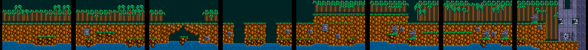

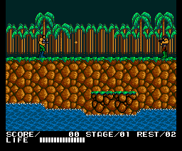

## Fase 2: 1ST UNDERPASS

La primera base en 3D ([Las bases](LAS-BASES.html)).

## Fase 3: HOMICIDE CENSOR NO.1

La pared del jefe de la primera base: una sola pantalla.

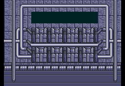

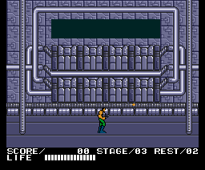

## Fase 4: HELL FALL

Una cascada, hacia arriba. Ocho pantallas; arriba del todo, la puerta con la cabeza.

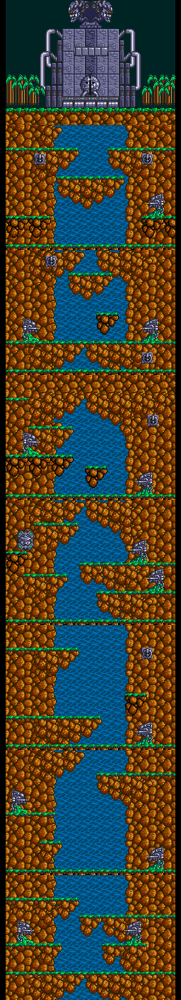

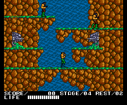

## Fase 5: 2ND UNDERPASS

La segunda base ([Las bases](LAS-BASES.html)).

## Fase 6: HOMICIDE CENSOR NO.2

La pared del jefe de la segunda base.

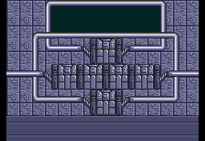

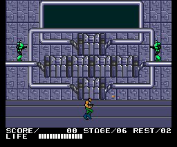

## Fase 7: TUNDRA AREA

Bosque nevado y rocas, con un tanque. Ocho pantallas hacia la derecha; al final, un soldado gigante.

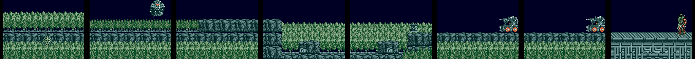

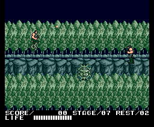

## Fase 8: ENERGY ZONE

Tuberías y cintas. Siete pantallas hacia la derecha; al final, otra vez el soldado gigante.

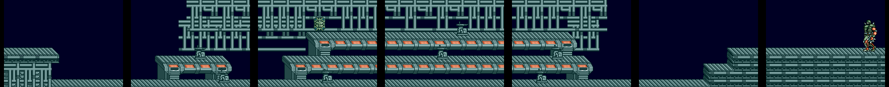

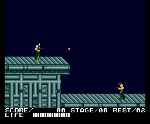

## Fase 9: ALIEN ZONE

Carne alienígena. Ocho pantallas hacia la derecha; al final, un corazón.

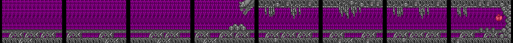

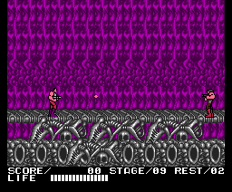

## Fase 10: CAVERN

Una cueva, hacia abajo. Ocho pantallas; abajo del todo, un núcleo en la roca.

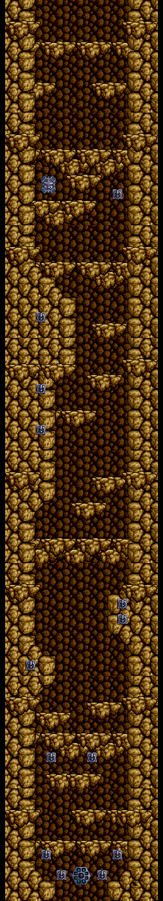

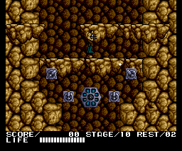

## Fase 11: 1ST UNDER MAZE

La tercera base ([Las bases](LAS-BASES.html)).

## Fase 12: HOMICIDE CENSOR NO.3

La pared del jefe de la tercera base.

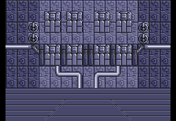

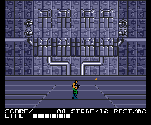

## Fase 13: MAGMA AREA

Roca y lava, hacia la izquierda. Ocho pantallas; a la izquierda del todo, un núcleo.

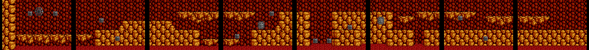

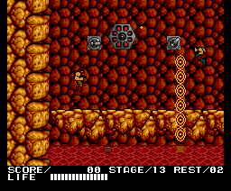

## Fase 14: 2ND UNDER MAZE

La cuarta base ([Las bases](LAS-BASES.html)).

## Fase 15: HOMICIDE CENSOR NO.4

La pared del jefe de la cuarta base.

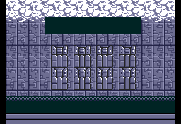

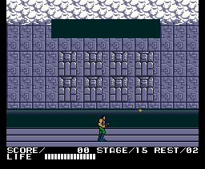

## Fase 16: UNDERGROUND FALL

Otra cueva, hacia abajo. Diez pantallas; abajo, un núcleo.

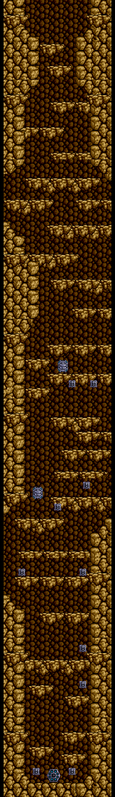

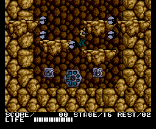

## Fase 17: MAGMA AREA

Otra vez roca y lava, con otro mapa. Siete pantallas hacia la izquierda.

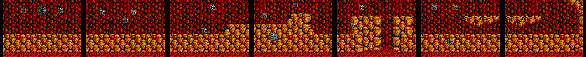

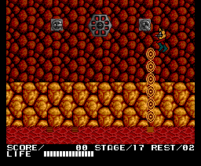

## Fase 18: UNDERGROUND FORTRESS

Escaleras y pasarelas, hacia arriba. Ocho pantallas; arriba, un núcleo.

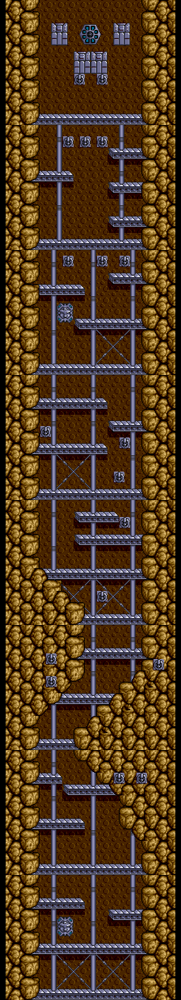

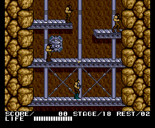

## Fase 19: VICIOUS SPACE

La guarida. Ocho pantallas hacia la derecha; al final, el último jefe.

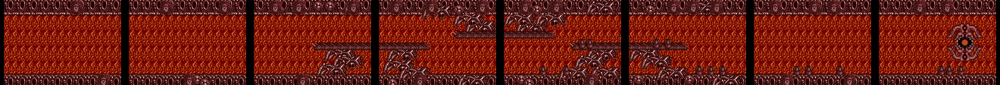

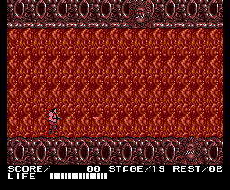

## TRAP HANGAR

La que el juego se salta. Sus seis pantallas son la misma ([Curiosidades](CURIOSIDADES.html)).

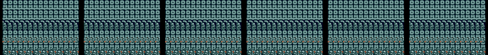
