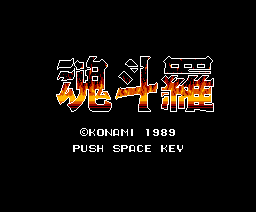
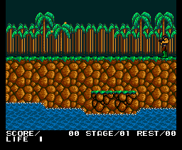
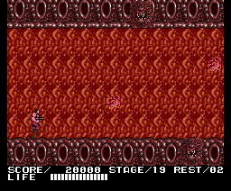

# Las secuencias

Todas son el cartucho ejecutado cuadro a cuadro, y cada pantalla se ha cotejado con la VRAM de openMSX: iguales byte a byte.

## El logotipo y el título

El logotipo de Konami y el título, 魂斗羅 (*Contra*), con su música (la 0x02). Al acabar la música sin que se pulse nada, empieza una demostración (`p00:41F9`).

## Las demostraciones

Hay tres, una detrás de otra: la fase 1, la 4 (HELL FALL) y la 6 (HOMICIDE CENSOR NO.2) (`p00:4245-4253`). El mando sale de una grabación de la ROM (`p12:9C00`, `p12:9D60` y `p12:9EC0`), y el jugador lleva una vida y una sola de energía, así que la demostración se acaba al primer golpe (`p00:423A`). En la demostración, F5 calla la música o la vuelve a poner (`p00:4E50`).

## El final

Al romper el último jefe, la paleta se apaga en 16 pasos (`p12:9407`), la pantalla se queda en negro y el texto sale por bloques, apareciendo y desapareciendo, mientras suena la música de la fase 1 (`p12:9400`; el texto, en [Los textos](LOS-TEXTOS.html)). Luego, otra vez el logotipo.

El texto acaba dejando la puerta abierta: *¿de verdad están destruidos los alienígenas... o no?*
